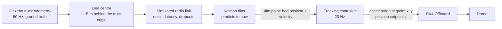

# Controllers, Kalman filter and the error measurements

How the drone follows and lands on the truck bed: the tracking controllers and how each one is configured, the Kalman filter that estimates where the bed is, and what every error number in the videos means. The numbers are from the runs on 2026-10-18 (PID: `logs/run_20261018_105148.csv`, LQI: `logs/run_20261018_120347.csv`, LQR: `logs/run_20261018_120635.csv`, LQI without Kalman filter: `logs/run_20261018_124456.csv`). Which configuration each run and video used is in [VIDEOS.md](VIDEOS.md).

Code: `ros2_ws/src/flatbed_falcon/flatbed_falcon/landing_logic.py` (control law, state machine), `target_filter.py` (link and Kalman filter), `target_tracker.py` (the ROS node around the filter). Every parameter is in `ros2_ws/src/flatbed_falcon/config/falcon.yaml` or has its default in the code.

## 1. Signal chain



- The drone does **not** see the truck with its camera. It flies to the bed position it receives over a simulated radio link, after filtering. The gimbal camera only points at the bed for the videos.
- Everything is in PX4's local frame, NED: x north, y east, z down. The drone spawns at the world origin, so the frames differ only by the ENU↔NED swap (`frames.py`).

## 2. The tracking controllers

### 2.1 The control law, the same for every mode except `px4`

The horizontal axes (x, y) are a **double integrator**: the controller commands an acceleration, and PX4's own loops turn it into attitude and thrust. With `e = p_aim − p_drone`, where the aim point is the Kalman estimate of the bed centre:

```
v_ref = v_truck + clip(kp/kd · e, v_rel_max)         chase speed relative to the truck
v_ref = clip(v_ref, v_max)                            absolute speed limit
a     = a_truck + kd · (v_ref − v_drone) + ki · ∫e dt
a     = clip(a, a_max)                                ≈ 22° tilt
```

For small errors (no clipping) this is exactly the PD/PID law

```
a = a_truck + kp · e + kd · (v_truck − v_drone) + ki · ∫e dt
```

For large errors, such as the approach from far away, it becomes a speed-limited chase instead of a huge acceleration.

- **Feed-forward:** `v_truck` and `a_truck` come from the Kalman estimate. `a_truck` is only the **centripetal** acceleration (`ω × v` from the yaw rate). Speed changes along the road are not fed forward, so the controller has to correct for them through the error.
- **The integral term** (modes `pid` and `lqi`) only integrates while |e| < `i_window` = 1 m, and only in TRACK, DESCEND and TOUCHDOWN. It is limited so that |ki·∫e| ≤ `i_acc_limit` = 1.5 m/s² (anti-windup). It resets at the start of each new chase (APPROACH) and is kept through DESCEND, TOUCHDOWN and ABORT, since the drag it holds is still there.
- **Why an integral term is needed:** the x500 in Gazebo has rotor drag, about 0.16 s⁻¹ × speed (it needs ~0.65 m/s² forward to hold 4 m/s). At constant speed this is a constant force that a PD can only hold with a constant error, `e ≈ drag·v/kp`. That's 0.5–1 m behind the bed, more than the 0.3 m descent gate.

Shared limits (`ControlParams`):

| Parameter | Value | |
|---|---|---|
| `rate_hz` | 20 Hz | control rate |
| `v_rel_max` | 10 m/s | max chase speed relative to the truck |
| `v_max` | 12 m/s | absolute horizontal speed limit (PX4's MPC_XY_VEL_MAX) |
| `a_max` | 4 m/s² | horizontal acceleration limit |
| `i_window` | 1 m | integrate only below this error |
| `i_acc_limit` | 1.5 m/s² | max integral contribution |

### 2.2 The modes and how they are configured

Pick one with `control_mode` under `landing_controller` in `falcon.yaml`. The default is `pid`.

| Mode | kp [s⁻²] | kd [s⁻¹] | ki [s⁻³] | Where the gains come from |
|---|---|---|---|---|
| `pd` | 1.200 | 2.200 | – | Hand-tuned, `control_kp`, `control_kd`. ζ = kd/(2√kp) = 1.0 (critically damped) |
| `pid` (default) | 1.200 | 2.200 | 0.300 | The same plus `control_ki`. Stable while ki < kp·kd = 2.64 |
| `lqr` | **1.074** | **1.579** | – | Discrete LQR, see below |
| `lqi` | **1.875** | **2.008** | **0.582** | Discrete LQR with an integral state, see below |
| `px4` | – | – | – | PX4's own position controller (has an integrator), see below |

The controller prints the gains it uses at startup: `Control mode lqi: kp 1.875, kd 2.008, ki 0.582`.

**LQR (`lqr`).** One horizontal axis as a discrete double integrator at the control rate (dt = 0.05 s), with the state being the error and its rate of change:

```
x = [e, ė]      A = [[1, dt], [0, 1]]      B = [[dt²/2], [dt]]
Q = diag(lqr_q_pos, lqr_q_vel) = diag(1.0, 0.3)      R = lqr_r = 0.8
```

`scipy.linalg.solve_discrete_are` gives P, and `K = (R + BᵀPB)⁻¹ BᵀPA = [kp, kd]`. The gains then go into the same control law as above. LQR has **no integral term**, so it has the same steady drag error as the PD.

**LQI (`lqi`).** The same model, augmented with the integral of the position error as a third state:

```
x = [∫e, e, ė]   A = [[1, dt, 0], [0, 1, dt], [0, 0, 1]]   B = [[0], [dt²/2], [dt]]
Q = diag(lqi_q_int, lqr_q_pos, lqr_q_vel) = diag(0.3, 1.0, 0.3)      R = 0.8
```

`K = [ki, kp, kd]` comes from the same Riccati equation and goes into the control law with the integral term. It has the same anti-windup and integration window as `pid`. Stability holds since ki = 0.58 < kp·kd = 3.77.

The weights are code defaults (`landing_logic.py`, `ControlParams`). Change them without editing code by adding `control_lqr_q_pos`, `control_lqr_q_vel`, `control_lqr_r` or `control_lqi_q_int` to `falcon.yaml`. A higher `q_pos` relative to `r` gives a stiffer controller (higher kp). A higher `q_int` gives a stronger integral term.

**PX4 (`px4`).** Our controller sends no acceleration of its own. It sends the aim point's position, velocity and acceleration as setpoints, and PX4's cascaded position and velocity controller (with an integrator) does the work.

### 2.3 Vertical axis and state machine (the same for every mode)

The vertical axis isn't part of the controllers above. The state machine gives PX4 a **position setpoint for z**, ramped at fixed rates, plus feed-forward of the bed's vertical velocity:

| State | What happens | Leaves when |
|---|---|---|
| IDLE | waits for PX4, arms, switches to Offboard | after 2 s with a fresh target |
| TAKEOFF | climbs at 2 m/s to `cruise_alt` = 25 m (clears the trees) | at cruise height |
| APPROACH | chases the truck at cruise height, no integral | horizontally closer than `capture_dist` = 8 m |
| TRACK | sinks at 1 m/s to `h_track` = 4 m above the bed and follows it | **gate** + truck's LANDING_OK |
| DESCEND | descends at 0.5 m/s, still following | at 0.2 m above the bed → TOUCHDOWN |
| TOUCHDOWN | pushes down at 1 m/s to settle on the bed | contact, or 0.3 s still within 0.08 m → LANDED |
| LANDED | disarms | – |
| ABORT | climbs back to 4 m, then TRACK again | |

- **The gate**, which sends READY_TO_LAND to the truck: |drone→aim| < 0.3 m **and** |velocity error| < 0.3 m/s **and** height within 0.3 m of 4 m, all for 1.5 s. READY_TO_LAND is only withdrawn if the error grows past 3 m.
- **The handshake:** the truck answers LANDING_OK on a landing zone (a straight) with at least 10 s left (4 m / 0.5 m/s + 2 s margin), and then holds `v_land` = 4 m/s.
- **Abort in DESCEND:** if the drone leaves the glide cone |e| > 0.2 + 0.1·height (0.6 m at 4 m height, 0.2 m at the bed), if the truck withdraws permission, or if less than 2 s of landing zone remain.
- **Abort in TOUCHDOWN:** if |e| > 0.5 m, or no landing is detected within 4 s.
- **Lost target:** a target older than 0.5 s (link dropouts, tracker stopped) means ABORT: hold position and climb.

### 2.4 Are the rules sensible?

We kept all the rules unchanged for every run, so the runs can be compared. Our assessment:

| Rule | Value | Assessment |
|---|---|---|
| Cruise height | 25 m at 2 m/s | Sensible: the trees are about 20 m tall |
| APPROACH → TRACK | within 8 m horizontally | Sensible: only a switch from chase to follow |
| Tracking height | 4 m | Sensible: a clear margin above the cab and the bed |
| Gate, position and velocity | 0.3 m, 0.3 m/s for 1.5 s | Sensible: the drone has to be locked on before it descends. Conservative compared with the bed's 1 m half-width, which leaves margin for the error to grow during the descent |
| Gate, height | ±0.3 m around 4 m | **Stricter than safety requires**, see below |
| Withdraw READY_TO_LAND | only above 3 m error | Sensible: hysteresis, so the request doesn't flip-flop when the truck brakes to 4 m/s |
| LANDING_OK | on a straight with ≥ 10 s left, then a constant 4 m/s | Sensible: it removes the two biggest error sources, curves and speed changes |
| Descent | 0.5 m/s | Sensible |
| Glide cone | 0.2 + 0.1·height | **Does not match the touchdown limit**, see below |
| TOUCHDOWN / LANDED | 0.2 m / contact or 0.3 s still within 0.08 m | Sensible |
| Abort in TOUCHDOWN | above 0.5 m, or 4 s | Sensible on its own, but in practice never limits (see the glide cone) |

**Weaknesses we know about (possible improvements):**

1. **The height condition in the gate checks the wrong thing.** It is meant to answer "has the height control settled?", but it measures the height against the **estimated bed height**. With a noisy estimate (no Kalman filter), the noise itself makes the condition fail. In the run without Kalman, the drone hovered at 3.2 m and never got permission. Descending from 3.2 m would have been harmless (the descent would just have been 1.6 s shorter). A better rule would compare the drone with **its own height setpoint** (the ramp) and/or use a window of about ±0.5 m. The gate still caught a real problem: the drone wasn't flying at the height it was commanded to (see 4.3).
2. **The glide cone and the touchdown limit contradict each other.** The cone narrows to 0.22 m when TOUCHDOWN starts (at 0.2 m height), while TOUCHDOWN allows 0.5 m. So the effective limit is 0.22 m, and the 0.5 m limit hardly ever matters. A cone ending at about 0.45 m would be consistent and still well within the bed.
3. **Every condition is measured against the Kalman estimate, not the true bed.** That's unavoidable, since a real drone doesn't know the truth. But it means a biased estimate can pass the gate falsely. With a filter error of about 0.02 m this was no problem here; it would be with more latency or without the filter.

## 3. The Kalman filter

### 3.1 Where the measurements come from: the simulated radio link

- **Source:** Gazebo publishes the truck's odometry (`/truck/odom`, ground truth) at 50 Hz. `target_tracker` converts it to the **bed centre**: 1.15 m behind the truck's origin and 1.0 m up. The bed's velocity includes the rotation (`v + ω × r`). The result is converted to PX4's local NED.
- **The link** (`SimulatedLink`) turns the ground truth into what a real radio would deliver. All settings are under `target_tracker` in `falcon.yaml`:

| Parameter | Value now | Meaning |
|---|---|---|
| `link_pos_noise` | 0.1 m | Gaussian noise (std) on each axis of the position, horizontal **and** vertical |
| `link_vel_noise` | 0.05 m/s | Gaussian noise on each velocity axis |
| `link_latency` | 0.1 s | each measurement arrives this much later than it was taken |
| `link_dropout` | 0.05 | probability that a measurement is lost |
| `link_seed` | 0 | random seed, so runs are reproducible |

Every measurement carries the time it was **taken** (`t`), not when it arrived. That's what makes it possible to compensate for the latency.

### 3.2 Model

A **constant-velocity Kalman filter in 3D** (`TargetEstimator`). The state is the bed's position and velocity:

```
x = [x, y, z, vx, vy, vz]ᵀ

Prediction over dt:   x⁻ = F x        P⁻ = F P Fᵀ + Q
F = [[I, dt·I], [0, I]]                (position += velocity · dt)
Q = σa² · G Gᵀ,  G = [[dt²/2 · I], [dt · I]]
```

- **Process noise:** `σa` = `filter_accel_std` = **1.0 m/s²**. It's the assumed random acceleration of the truck (speed changes, curves) that the model doesn't know about.
- **Measurement:** position **and** velocity directly, so `H = I`:

```
z = [x, y, z, vx, vy, vz]ᵀ (from the link)
R = diag(σp², σp², σp², σv², σv², σv²)
σp = max(link_pos_noise, 0.02) = 0.1 m     σv = max(link_vel_noise, 0.02) = 0.05 m/s

S = P⁻ + R        K = P⁻ S⁻¹        x = x⁻ + K (z − x⁻)        P = (I − K) P⁻
```

`R` follows the link's noise, with a floor so the filter stays sane even when the link is noise-free.

### 3.3 How it runs

1. **When a measurement arrives:** predict from the time of the last update to the **measurement's own time** `t`, then update. Measurements that are older than or equal to the latest one (out of order, or duplicates) are dropped.
2. **Every 20 ms (50 Hz):** predict from the last update to **now** (+ `predict_ahead` = 0) and publish that as the aim point (`/falcon/target`). That compensates for the link latency: the measurement says where the bed *was* 0.1 s ago, and the filter extrapolates to where it is *now*.
3. **Yaw** isn't in the filter. It's taken from the latest measurement and extrapolated with its yaw rate.
4. **Dropouts:** the filter keeps predicting between measurements. If no measurement has come for 1 s, the tracker stops publishing. The controller treats a target older than 0.5 s as lost, which means ABORT, hold and climb.
5. **`use_filter: false`:** extrapolate the latest measurement with its velocity, with no filtering. It's there as a baseline to compare against.

### 3.4 What the filter does with these settings

The steady-state Kalman gain at 50 Hz with σp = 0.1 m, σv = 0.05 m/s and σa = 1 m/s², computed with the filter's own code:

| | Value |
|---|---|
| Position gain (how much of a position measurement it takes in) | **0.010** |
| Velocity gain | **0.33** |
| Remaining uncertainty (std) | 0.010 m in position, 0.029 m/s in velocity |

The filter barely trusts single position measurements. The position is mostly the integrated velocity estimate, nudged slowly toward the measurements. Since the velocity measurement is much more precise than the position (0.05 m/s against 0.1 m), that's the right weighting.

**Why the height is in the filter too:** at first the filter was horizontal only, and the height was copied unfiltered from the measurement. With 0.1 m of height noise, the bed height jumped every measurement. The height ramp turned that into vertical velocity commands with about 1.2 m/s of noise, and the drone held ~0.85 m too low and never got within the gate's height window. With z in the filter, the height noise dropped from 0.099 m to 0.013 m (std), and the drone landed.

## 4. The error measurements in the videos

### 4.1 The definitions

All horizontal errors are distances **in the xy plane**, between points as seen from above, with height ignored. In TRACK the drone flies 4 m above the bed on purpose, and height has its own measurement.

| Name in the video | Definition | Measures | Where |
|---|---|---|---|
| **drone → bed** / **horizontal error drone → true bed** / **error now** | xy distance from the drone (PX4's EKF2 estimate) to the **true** bed centre (from Gazebo) | The actual result: is the drone over the bed? | all |
| **drone → aim** | xy distance from the drone to the **Kalman estimate** of the bed (`e_xy` in the controller) | How well the controller follows its aim point. This is what the controller sees and what the gate uses | single overlay |
| **raw link error** / "link" in the plot | xy distance from the **latest received link measurement** to the true bed | How bad the raw information is | single overlay |
| **filtered error** / "filtered" in the plot | xy distance from the **Kalman estimate** to the true bed | How good the filter's information is | single overlay |
| **height above bed** | bed height (estimate) minus drone height. Hidden once landed | Should be 4 m in TRACK, then ramp down to 0 | all |
| **touchdown error** | drone → true bed at the moment of LANDED | Where it landed | all |
| **drone speed / truck speed** | horizontal speed of the drone (PX4) and the truck (Gazebo) | | single overlay |
| **bed from above** | the bed in the truck's frame (driving direction up). Orange: link measurements from the last second. Blue cross: Kalman estimate. Ring/dot: the drone. Grid 1 m | | all |

Roughly: **drone → true bed ≈ drone → aim + filtered error**. With the filter at about 0.02 m, the first two are almost the same.

How to judge them: the bed is 2.5 m long and 2.0 m wide, so an error under ~1 m is still over the bed. The **gate is 0.3 m**, the glide cone allows 0.6 m at 4 m height and 0.2 m at the bed, and touchdown aborts above 0.5 m.

### 4.2 Measured values (TRACK at 4 m height, medians, 90th percentile in parentheses)

| | PID | LQR | LQI | LQI **without Kalman** |
|---|---|---|---|---|
| Truck speed (median) | 5.8 m/s | 7.5 m/s | 5.8 m/s | 7.4 m/s |
| Raw link error | 0.61 m (0.90) | 0.74 m (0.91) | 0.61 m (0.90) | 0.73 m (0.91) |
| Filtered error (without Kalman: the extrapolation) | 0.017 m (0.032) | 0.018 m (0.032) | 0.017 m (0.031) | 0.118 m (0.215) |
| Drone → aim | 0.65 m | 0.84 m | 0.37 m | 0.24 m |
| Drone → true bed | 0.66 m (1.25) | 0.84 m (1.38) | 0.38 m (1.09) | 0.20 m (0.62) |
| Along the driving direction (median) | −0.05 m | **−0.84 m (behind)** | −0.01 m | −0.01 m |
| Height above bed (median, std) | 4.00 m (0.02) | 4.00 m (0.02) | 4.00 m (0.02) | **3.17 m (0.14)** |
| Landed | 49 s after TRACK | never (≈180 s in TRACK) | **45 s after TRACK** | never (≈188 s in TRACK) |
| Why not | – | position condition (lags behind) | – | **height condition** (0.8 m too low) |
| Touchdown error, true bed (video) | 0.04 m | – | 0.09 m | – |
| Touchdown error, controller's log (vs. estimate) | 0.04 m | – | 0.02 m | – |

### 4.3 How the numbers can be explained

**Raw link error ≈ 0.6 m: mostly latency, not noise.** A measurement is 0.1 s old when it arrives, and the truck moves 0.1 s × 5.8 m/s ≈ 0.58 m in that time. The noise adds only ~0.12 m horizontally (0.1 m per axis). In the LQR run the truck drove faster on average (7.5 m/s, since it never slowed down for a landing), hence the larger raw error. In the bed view the orange dots therefore sit **behind** the bed in a trail, not scattered around it.

**Filtered error ≈ 0.02 m: the filter removes almost all of it.** It predicts each measurement forward from the time it was taken to now, using its velocity estimate, which cancels the latency. It also averages away the noise (position gain 0.01). What remains comes from speed changes and curves that the constant-velocity model doesn't know about. In the plots the blue line lies flat near zero while the orange one scatters around 0.6 m.

**Drone → aim: this is where the controllers differ.** The aim point is accurate, so the remaining error is the controller's:
- **LQR: −0.84 m, steadily behind.** Without an integral term, the drag force is held with a constant error, about drag·v/kp. At the truck's 6–8 m/s and kp = 1.07 that is ~1 m, in the same range as what we measured. It never gets under the 0.3 m gate, so it never asks to land. In the bed view the orange dot hangs at the back edge of the bed, and in the error plot the orange line lies flat around 0.8–1 m.
- **PID: no steady lag** (−0.05 m along the driving direction), thanks to the integral term, but a median of 0.65 m. It's softer (kp 1.2, ki 0.3), so it lags further behind in transients.
- **LQI: the lowest error (0.38 m).** The Riccati solution gives it higher gains than the hand-tuned PID (kp 1.88 vs 1.2, ki 0.58 vs 0.3), so it corrects both transients and drag faster. It passes the gate sooner and landed 4 s earlier than PID after TRACK.

**Spikes in the error plots (1–1.6 m): curves and speed changes.** The truck slows down in curves (the speed profile `v ≤ √(a_lat/|curvature|)`) and speeds up afterwards. Only the centripetal acceleration is fed forward, not the speed change along the road, so the controller first notices it through the error. Also, the integral term only works below 1 m error, so it doesn't help in the largest spikes. All three controllers have the spikes in the same places; LQI's are the smallest.

**Touchdown error 0.09 m vs. 0.02 m (LQI).** The video measures against the **true** bed. The controller logs its error against the **Kalman estimate**. The difference is the filter's error at that moment plus the 20 Hz logging. Both are far inside the bed (1.25 × 1.0 m from the centre to the edge) and the 0.5 m limit.

**Height above bed:** 25 m during approach, then a ramp down to 4 m at 1 m/s, flat at 4 m in TRACK, then down at 0.5 m/s in DESCEND. It stays exactly at 4 m in all the runs because the bed height is filtered. In the run before the height was in the filter, it hovered around 3.15 m.

**LQI without Kalman filter: fine horizontally, but it never gets permission to land because of the height.** With `use_filter: false` the tracker only extrapolates the latest measurement with its velocity, with no smoothing.
- **Horizontally** that's good enough. The extrapolation cancels the latency, so the aim point is 0.12 m off (against 0.02 m with Kalman), and the drone tracked the bed with a median of 0.20 m. It even met the gate's position and velocity conditions about 60% of the time in TRACK. That it tracked better horizontally than LQI with Kalman (0.20 vs. 0.38 m) is one run against one run, with different traffic (the truck never slowed down for a landing), so it should not be read as "better without a filter".
- **Vertically** it doesn't work. The bed height comes raw from the link with 0.1 m of noise in every measurement (std 0.100 m, against 0.008 m with Kalman). The height ramp aims at "bed height + 4 m" and turns every jump into a vertical velocity command, about ±1.2 m/s of noise. The drone then hovered at **3.17 m instead of 4.00 m** with 0.14 m spread, and was **never** within the gate's ±0.3 m window. So it never sent READY_TO_LAND.
- We have **not** explained why the noise gives a constant offset of 0.8 m downward rather than just shaking around 4 m. The setpoint itself stays on average at the right height (checked offline), so the bias arises in PX4's vertical control. An asymmetry in thrust (pushing down versus up) is a possible explanation, but it isn't verified.
- **Conclusion:** in this setup the Kalman filter is needed **mainly for the height**, not for the horizontal tracking. The gate's height condition is stricter than required (see 2.4), but it caught that the drone wasn't flying at its commanded height.

**After landing:** the drone is disarmed, and its logged position starts drifting (PX4's estimate is no longer controlled), which made the error grow to 2 m in the first version of the comparison video. That's why every video freezes the error at the touchdown moment and hides the height.

## 5. Notes on the comparison

- One run per controller. The landing time and touchdown error vary from run to run. The steady LQR lag and the tracking errors are averages over many seconds of tracking and are more reliable.
- All runs had the same truck, the same start and the same link settings (0.1 m / 0.05 m/s / 0.1 s / 5%, the same seed). All of them had the Kalman filter on, except "LQI without Kalman". The PID run was recorded before the LQI/LQR runs with the same configuration.
- An LQR run without Kalman was started but stopped after 89 s on request, before it got anywhere. It is not part of the comparison.
- The offline tests (`test/test_offline.py`) cover the same behaviour without Gazebo: every mode lands on ground truth, PID/LQI/PX4 land with drag, PD/LQR never pass the gate with drag, LQI gives stable gains, and the filter smooths the height.

## 6. Reproducing it

```bash
# 1. pick a controller in ros2_ws/src/flatbed_falcon/config/falcon.yaml: control_mode: lqi
cd docker && ./start-stellar.sh --record          # terminal 1
./ros2_ws/run.sh                                  # terminal 2

# 2. comparison video straight from the CSV logs
.venv/bin/python tools/compare_video.py "PID=logs/run_A.csv" "LQR=logs/run_B.csv" "LQI=logs/run_C.csv"

# 3. replay a run, record it in Gazebo, then add the overlay
./docker/replay.sh <gazebo log> -a drone_chase    # start recording while it is paused (offset = the printed time)
.venv/bin/python tools/overlay_video.py <gazebo log> --video rec.mp4 --offset 3
.venv/bin/python tools/side_by_side.py "LQI=lqi.mp4@<log A>+3" "LQR=lqr.mp4@<log B>+3" --out videos/lqi_vs_lqr.mp4
```
