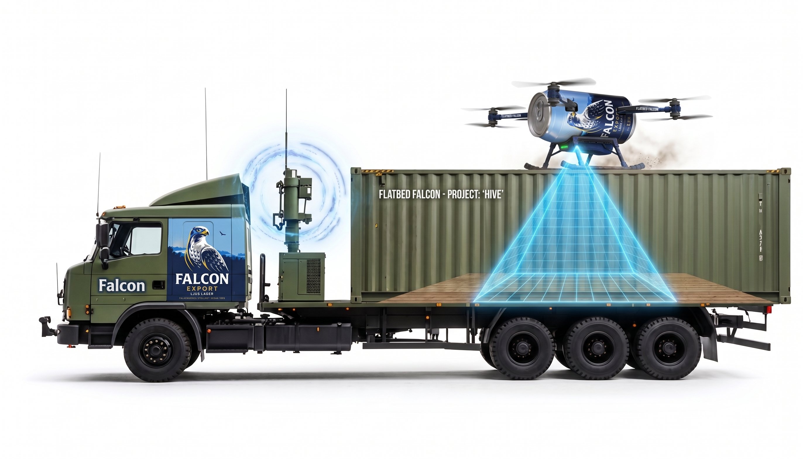

# Flatbed Falcon



A drone (PX4, x500) that autonomously tracks and lands on the flatbed of a moving pickup truck in Gazebo. Project for the Autonomous Vehicles course.

The truck drives laps on a 1.1 km forest road loop with Pure Pursuit, shares its position over ROS 2, and the drone follows it with PX4 Offboard setpoints before descending onto the flatbed on one of the straight landing zones.

See [PLAN.md](PLAN.md) for the design and work plan.

**Videos:** the final presentation video (3:06) and all recordings, overlays and comparison clips are in this [Google Drive folder](https://drive.google.com/drive/folders/1Q1wMDsK5-q4DVrhlGSGVsWqEiBOJH4Jf?usp=sharing) (`flatbed_falcon_videos_2026-10-18.zip`, 1.3 GB). What each video shows and how it was made: [VIDEOS.md](VIDEOS.md). Controllers, Kalman filter and the error measurements: [CONTROLLERS.md](CONTROLLERS.md). Narration script: [PRESENTATION_SCRIPT.md](PRESENTATION_SCRIPT.md).

## Running

```bash
cd docker && ./start-dev.sh        # macOS: builds the image, starts PX4 + Gazebo (hive_base world)
./ros2_ws/run.sh                   # second terminal: builds and launches all nodes
./ros2_ws/view-camera.sh           # optional, third terminal: the gimbal camera in RViz
```

On the Stellar computers use `docker/start-stellar.sh` instead (see [docker/README-stellar.md](docker/README-stellar.md)).

The drone takes off from the camp, chases the truck and lands on its bed by itself. Each run writes a CSV to `logs/`. All tuning lives in `ros2_ws/src/flatbed_falcon/config/falcon.yaml` (controller mode and gains, speeds, landing gate, simulated link noise/latency, Kalman filter); `./ros2_ws/run.sh` rebuilds and picks up edits.

### Recording a video

Start with `--record` to also save a Gazebo log of the run (poses only, nearly free) to `logs/gz/<timestamp>/`:

```bash
cd docker && ./start-dev.sh --record   # or ./start-stellar.sh --record
```

Afterwards, stop PX4 (Ctrl+C in its terminal) but keep the container running, then replay the newest log with the camera chasing the drone:

```bash
./docker/replay.sh                     # -f truck to follow the truck, -o -12,0,6 for another offset
```

In the Gazebo window, click the video camera icon (top left) and pick mp4, press play, and click the icon again to stop. Save under `/workspace/` so the file lands in this folder. The recorder runs on sim time in lockstep with the replay, so a slow Mac only makes the export take longer.

### Filming several angles

`--film` adds camera rigs to the world: four that ride with the truck (chase, side, cab roof looking at the bed, overhead) and a fixed tripod beside each landing zone. `film.sh` records them all at once from the same run, one mp4 per angle in `videos/<timestamp>/`, so the clips line up when you edit them together:

```bash
cd docker && ./start-dev.sh --film     # terminal 1
./ros2_ws/run.sh                       # terminal 2
./docker/film.sh                       # terminal 3: Enter stops, or it stops 20 s after touchdown
./docker/film.sh -s truck_chase,bed_closeup,tripod_z0   # only some angles
```

The cameras record on sim time, so the videos are smooth and play at real speed however slow the computer is. Each recording camera slows the sim down instead, a lot on a Mac, so pick a few angles with `-s` if a run takes too long, or start with a lower resolution and frame rate: `FILM_RES=960x540 FILM_FPS=15 ./start-dev.sh --film` (default 1280x720, 25 fps).

### Filming the same run from many angles (cheapest)

Record the run with `--record` (it only saves poses, so the sim runs at normal speed), then replay it once per angle and film each pass with the Gazebo window's video button (top left, pick mp4, press play, click again to stop and save under `/workspace/`):

```bash
cd docker && ./start-stellar.sh --record --film   # --film only for the gimbal view below
./ros2_ws/run.sh
./docker/film.sh -s gimbal                        # optional: the drone's own camera, live (one camera, cheap)
# after the landing, stop PX4, then once per angle:
./docker/replay.sh -a drone_chase                 # also truck_chase, truck_side, overhead, bed_closeup, tripod_z0..2
```

To film every angle with no clicking, run `./docker/replay_all.sh` instead (or `-s truck_chase,overhead` for some). It opens one replay per angle, saves a screenshot for every frame and writes `videos/<log>/<angle>.mp4`. It takes longer than the run, but the videos keep the real speed. It needs ffmpeg (`python3 -m pip install --user imageio-ffmpeg` if missing).

The drone's gimbal camera can only be filmed live (`film.sh -s gimbal`), since sensors do not run in a replay.

### Tracker view

The drone does not see the truck through its camera: it flies to the bed position it receives over the simulated link, after filtering. `tools/tracker_video.py` turns a run's CSV log into a video of exactly that (top-down: real truck and bed, link measurements, the filtered aim point, the drone, plus state, errors and height over time), with sim time in the corner so it lines up with the camera clips:

```bash
python3 tools/tracker_video.py                    # newest logs/run_*.csv -> videos/tracker_run_....mp4
```

It needs matplotlib and ffmpeg (`python3 -m pip install --user matplotlib imageio-ffmpeg` if missing).

Offline tests (no Gazebo), inside the sim container:

```bash
docker exec -it flatbed-falcon-sim bash -c "cd /workspace/ros2_ws/src/flatbed_falcon && PYTHONPATH=. python3 -m pytest -q test"
```

## Layout

| Path | Contents |
|---|---|
| `docker/` | Simulation container (PX4 + Gazebo + ROS 2 Jazzy, pinned image) |
| `worlds/` | Gazebo world (`hive_base.sdf`, generated by `generate_hive_base.py`), road centerline (`road_centerline.csv`) and tree models |
| `ros2_ws/src/flatbed_falcon/` | ROS 2 package with all nodes |

| Node | Role |
|---|---|
| `truck_driver` | Pure Pursuit (Lab 3) + speed profile along the road loop, landing handshake |
| `target_tracker` | Truck pose (world ENU) → bed target (PX4 local NED); simulated link + Kalman filter |
| `landing_controller` | Lab 4 PD/PID (or LQR) tracking + landing state machine → PX4 Offboard |
| `logger` | CSV logs for plots |

All frame conversions (ENU ↔ NED, spawn offset) live in `flatbed_falcon/frames.py`.

The simulation environment and world are reused from our Hive project (Projectcourse in AI); everything under `ros2_ws/` is new for this course.
